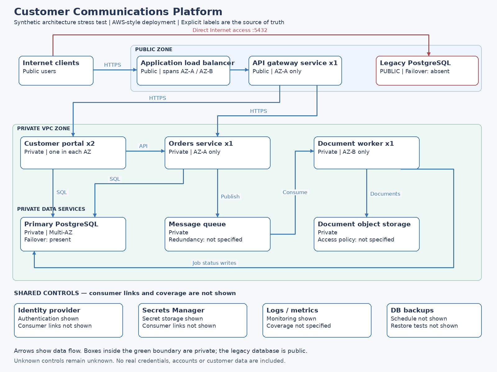

# Architecture Diagram Reviewer

### Turn an architecture diagram into an evidence-based review and an approved AWS infrastructure baseline.

Built for the **Meta AI Developer Hackathon**, Architecture Diagram Reviewer uses the **Meta Model API** to extract components, connections and diagram evidence from an uploaded image. You inspect and correct those observations, review risks, approve a scoped AWS target, and download traceable Terraform with an actual validation report from an isolated workflow.

**[Try the live demo](https://adr.sathishkannan.com/) · [Inspect a validated sample](docs/evidence/README.md) · [Recording walkthrough](docs/RECORDING.md)**

> The generated infrastructure is an illustrative **AWS ALB / Auto Scaling Group / RDS PostgreSQL baseline**. It does not reproduce every service in a diagram, migrate data, or deploy an application. Terraform validation checks configuration validity; it does not establish security or production readiness. No AWS plan or apply is run.

## The problem

Architecture diagrams capture valuable intent, but reviewing them often means manually finding exposed databases, single points of failure and missing control evidence. Turning that review into infrastructure introduces another challenge: keeping the generated resources connected to the observations and decisions that justified them.

This project makes that chain inspectable. It distinguishes what the diagram shows, what remains unknown, what the user approves, and what the generated target actually implements.

## How it works

1. **Extract with Meta.** Upload a PNG or JPEG. Meta produces a schema-validated graph with component labels, directed connections, evidence and provenance.
2. **Inspect and correct.** Compare the saved graph with the diagram. Record human corrections while retaining the original extraction and revision history.
3. **Review the evidence.** Deterministic checks flag application redundancy, database exposure and failover, plus unverified authentication, secrets, monitoring, backups, queue resilience and storage policies. Unverified coverage is not treated as proof of absence.
4. **Choose the target scope.** Select which observed database role the new PostgreSQL baseline represents, or retain an independent baseline. Inspect every component's included, replaced, omitted or unsupported disposition and the finding-to-target summary.
5. **Approve explicitly.** Acknowledge baseline assumptions, scope limitations and unresolved questions. Approval is bound to the exact graph and target revisions; saved changes invalidate it and previous artifacts.
6. **Generate and validate.** Render version-controlled Terraform templates. Run actual formatting, offline initialization and validation through GitHub Actions or local Docker, then download the results and audit files.

## Where Meta AI is used

The Meta Model API performs the **multimodal diagram-to-graph extraction**. The client uses the configured model (`muse-spark-1.3` by default), validates its structured response, and retains evidence and provenance for human inspection.

Risk checks, target construction and Terraform rendering are implemented in Python. Model output cannot provide executable commands, arbitrary Terraform resources or template names. This separates AI interpretation from the constrained infrastructure-generation path.

Images are validated and resized before being sent inline to Meta. The service does not write uploaded images to disk or log API keys. Provider-side handling follows Meta's terms. See [Meta integration details](docs/META_INTEGRATION.md) for the API contract and the original development verification record.

## Try the demo

Open **[adr.sathishkannan.com](https://adr.sathishkannan.com/)**.

- **Fixture example:** choose one of four synthetic examples to explore review, approval and downloads without an API key. Fixture replay does not make a live AI call.
- **Live Meta extraction:** the owner must configure the Meta key and provide the private demo code. Upload a diagram, inspect the extraction, save any truthful corrections, and continue through review and approval.
- **Terraform validation:** after generation, download `validation-request.json` and use **Open Terraform validation workflow**. Run it on `main` with that JSON; repository write access is required. Blank input validates only a synthetic complex fixture. [Step-by-step instructions](docs/TARGET_VALIDATION.md).

The free Render host handles the interactive demo and artifact generation. Its download correctly reports **`not_run`** because Terraform does not execute there. GitHub Actions creates a **separate validated ZIP** with the actual result. The app never automatically submits architecture data to GitHub.

Sessions are temporary and may reset when the free host sleeps. Keep API keys and the private demo code out of recordings and version control.

## Complex-diagram demonstration

The supplied complex CCM diagram contains **14 components and 12 connections**, including independent application services, two PostgreSQL databases, a queue, object storage and shared controls.



The supplied live run identified **five confirmed findings**, including the legacy database's direct Internet exposure and missing failover, and **six unverified control or resilience findings**. Its approved baseline passed Terraform validation with **zero errors and zero warnings**.

The current UI lets the reviewer select `legacy_postgresql` as the role represented by the new private Multi-AZ RDS. The summary then distinguishes:

| Observed issue | Proposed baseline measure | Remaining limitation |
| --- | --- | --- |
| Public legacy database | Private RDS with application-only PostgreSQL access | Existing database and data remain unchanged; no migration is performed. |
| Missing legacy database failover | Multi-AZ enabled on the new RDS | Recovery objectives and operational testing still need confirmation. |
| Single-instance independent services | Outside the fixed template's generated scope | One illustrative ASG does not implement or consolidate those services. |
| Unverified shared controls | Explicitly retained as unresolved or partially addressed | A control box or successful Terraform validation does not prove effective coverage. |

**[Download the validated live sample and read its provenance notes](docs/evidence/README.md).** This historical sample predates the database-role selector and is labelled accordingly; it is not a fresh validation of your current target.

## What the AWS baseline includes

- A two-Availability-Zone VPC with public ALB, private application and isolated database subnets.
- An HTTP Application Load Balancer and an EC2 Auto Scaling Group with at least two instances.
- Private, encrypted Multi-AZ RDS PostgreSQL, managed master credentials, seven-day backups and deletion protection.
- Scoped ALB-to-application-to-database security groups and an IMDSv2-required launch template.
- Resource-to-decision references for all **26 generated Terraform resources**.

**Outside the generated scope:** independent application/worker implementations, queues, object storage, production TLS, application authentication, monitoring integrations, application packaging, IAM access to managed credentials, NAT/endpoints and data migration. Private instances require additional integration before the application can function. Azure and Google Cloud templates are not implemented.

## Run locally

Use Docker Desktop with Linux/amd64 containers, or Docker on an x86-64 Linux host.

```bash
cp .env.example .env
# For live extraction, fill MODEL_API_KEY in .env. Never commit the real key.
docker compose up --build
```

Open **http://localhost:8501**. Fixtures need no Meta key. The first build needs Internet access to install dependencies and prepare the pinned Terraform/provider mirror. Local Docker provides the full validation flow.

For a Python-only UI and tests:

```bash
python -m venv .venv
# Linux/macOS: source .venv/bin/activate
# Windows PowerShell: .venv\Scripts\Activate.ps1
python -m pip install -e '.[test]'
python -m pytest -q
python -m streamlit run streamlit_app.py
```

Python-only mode supports extraction, editing, review and downloads. Validation reports `not_run` when the restricted Linux toolchain is unavailable. See [local quickstart](DEMO_QUICKSTART.md) and [hosted deployment guide](docs/RENDER_DEMO.md).

## Validation and traceability

Terraform **1.9.8** and AWS provider **5.100.0** are pinned. The Docker validator runs as non-root, uses the bundled provider mirror, blocks IP sockets in validation subprocesses, and has bounded runtime and output. The GitHub validation workflow additionally disables container networking and uses a read-only root filesystem and resource limits. It runs no cloud provisioning commands and needs no AWS credentials.

A validation request contains graph, target, approval and audit metadata—not arbitrary Terraform. The workflow regenerates trusted templates and verifies the revisions and expected Terraform/lock hashes. `validation-context.json` records request and output hashes so the report can be matched to the approved target. See [validation instructions](docs/TARGET_VALIDATION.md) and [mirror trust and formatting notes](docs/evidence/README.md).

| Download contents | Purpose |
| --- | --- |
| Terraform files and `.terraform.lock.hcl` | The constrained AWS baseline and pinned provider dependency. |
| Original/corrected graphs and `corrections.json` | Preserve observations and human revision history. |
| Findings, scope, questions, coverage and `remediation-summary.json` | Show what is known, proposed, unsupported and unresolved. |
| Approved target, `ADR.md` and `traceability.json` | Bind generated resources to acknowledged decisions and revisions. |
| Validation request, report and external validation context | Distinguish generated output from actual validation evidence. |

## Implementation and verification

| Layer | Technology |
| --- | --- |
| Interactive review | Streamlit |
| Diagram interpretation | Meta Model API |
| Graph validation and workflow | Python, Pydantic |
| Infrastructure generation | Version-controlled Jinja2 templates, Terraform AWS provider |
| Isolated validation and CI | Docker, libseccomp, GitHub Actions |
| Public demo hosting | Render Free |

The latest code checks passed **122 tests, with one skipped** on GitHub's runner. Docker initialization/validation and all four fixture workflows passed. The separate approved-target workflow also passed for the complex fixture with the legacy database role selected. These checks do not replace manual inspection of live extraction or the final demo recording.

- [Code and Docker checks](https://github.com/sathishkannan-labs/Architecture-Diagram-Reviewer/actions/runs/41846569716)
- [Approved-target validation run](https://github.com/sathishkannan-labs/Architecture-Diagram-Reviewer/actions/runs/41844339463)
- [Detailed implementation history and remaining acceptance work](IMPLEMENTATION_STATUS.md)
- [Final recording checklist](docs/RECORDING.md)

The optional [local FastAPI adapter](archreview/api.py) exposes the same workflow for developers. It is intended for localhost use, not as a publicly authenticated production API.
